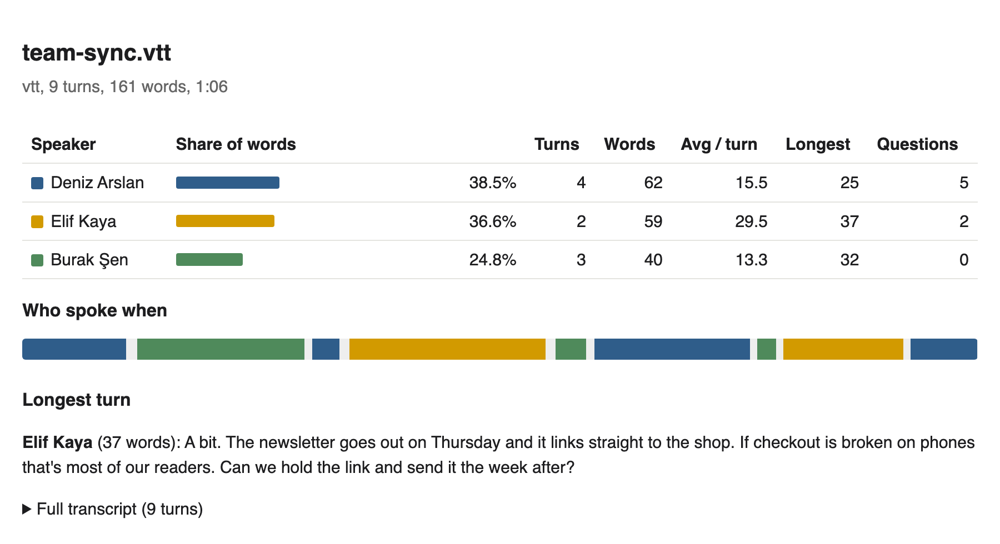

# transcript-kit

[](https://github.com/alidoganerr/transcript-kit/actions/workflows/test.yml) [](LICENSE)

Reads meeting and chat transcripts in the formats they usually come in, writes them out as one JSON shape, and counts who talked how much.

Supported: WebVTT as Zoom and Teams export it, SRT, WhatsApp chat exports (iPhone and Android, Turkish or English phone settings) and plain `Name: text` files with or without `[mm:ss]` stamps.

Example report: [a team call](https://alidoganerr.github.io/transcript-kit/) and [a WhatsApp group](https://alidoganerr.github.io/transcript-kit/hafta-sonu.html). Both transcripts are made up; they're in `examples/`.



## Usage

```
pipx install git+https://github.com/alidoganerr/transcript-kit
```

```
transcript-kit stats examples/team-sync.vtt
transcript-kit convert examples/hafta-sonu.txt -o chat.json
transcript-kit report examples/team-sync.vtt -o report.html
```

Needs Python 3.9 or later and nothing else. From a clone, `python3 transcript_kit.py` does the same.

```
team-sync.vtt (vtt, 9 turns, 161 words, 1:06)

speaker                   share  turns  words avg/turn  longest    ?
Deniz Arslan              38.5%      4     62     15.5       25    5
Elif Kaya                 36.6%      2     59     29.5       37    2
Burak Şen                 24.8%      3     40     13.3       32    0

Longest turn: Elif Kaya, 37 words at 0:25
```

The format is detected from the extension and the first lines; `--format vtt|srt|whatsapp|text` overrides it. `--rename "Speaker 1=Ayşe"` fixes names the recorder got wrong, and can be repeated. `stats --json` prints the numbers instead of the table.

## The JSON

```json
{
 "source": "team-sync.vtt",
 "format": "vtt",
 "turns": [
  {"speaker": "Deniz Arslan", "start": 2.12, "end": 9.3, "text": "Okay, I think everyone's here. ..."}
 ]
}
```

Back-to-back lines from the same person are merged into one turn. `start` and `end` are seconds from the start of the recording, or `null` when the source has no timing. Chat exports keep the clock time in `date` and `time` instead.

## What gets counted

Words, turns, share of words per speaker, average and longest turn, and questions. If the source has timing, also the total length and a strip showing who spoke when. Seconds per speaker are in the `stats --json` output.

A few things to know:

- A question is a sentence ending in `?`. Chat messages often skip the mark, so the count for WhatsApp is on the low side.
- In WhatsApp exports, system lines (encryption notice, someone joined) and "media omitted" lines are dropped. Other lines without a date are treated as the rest of the previous message.
- Any line that looks like `Name: text` is read as a new speaker, in every format. A sentence like "Note: we moved the date" becomes a speaker called Note.

Tests: `python3 -m unittest`. MIT licensed.
